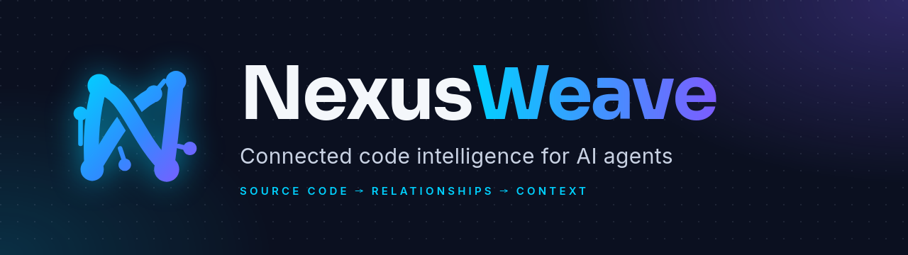

<p align="center">
  
</p>

<p align="center"><b>Understand more. Trace precisely. Ship with confidence.</b></p>

NexusWeave builds a graph of your codebase (symbols, calls, imports, inheritance, routes, events)
and serves it to AI coding agents over MCP. An agent asks one question and gets back the relevant
line-numbered source, the call path between the symbols it named, and what depends on them,
instead of a long grep → read → grep loop.

It is a single static Rust binary. The graph lives in SQLite inside your project, stays in sync
with your edits, and never leaves your machine. There is no telemetry.

NexusWeave is a ground-up Rust reimplementation of the ideas in
[colbymchenry/codegraph](https://github.com/colbymchenry/codegraph) (MIT).

## What you get, measured

Agent sessions with and without NexusWeave, on the same questions, graded by keyword rubric and
an LLM judge (`bench/agent/`, details and confidence intervals in `enhancements.md` §8):

| | small and mid-size repos (80–1.2k files) | large repos (django, vscode) |
|---|---:|---:|
| answer quality | unchanged (100% both ways) | unchanged (100% both ways) |
| tool calls | **−25%** | **−46%** |
| wall-clock time | −4% | **−15%** (faster on every task) |
| cost per question | about the same (+4%, within noise) | **+17%** |

- **Use it for speed and review tooling.** Agents finish in fewer, faster steps, and the graph
  powers things grep can't do: change impact on a diff, tests to run, dead code, import cycles,
  route maps, a call-graph viewer.
- **It does not lower API cost today.** `explore` answers arrive as fresh, full-price input, which
  outweighs the reading they replace. On flat-rate plans that doesn't matter; on per-token billing
  it currently costs slightly more.
- Its edges are accurate: **98–100% precision** against compiler ground truth for 7 languages
  (see [Accuracy](#accuracy)).

## Quick start

```bash
git clone https://github.com/AxiomOperator/NexusWeave.git && cd NexusWeave
cargo install --path .        # Rust 1.88+; one ~37 MB binary in ~/.cargo/bin
nexusweave install            # register the MCP server with your agents
cd your-project
nexusweave init               # build the graph (seconds; vscode's 15k files take ~10 s)
nexusweave explore "How does authentication work?"
nexusweave ui                 # optional: browse the graph at http://127.0.0.1:7878
```

Restart your agent after `nexusweave install` so it starts the server. From then on the graph
keeps itself up to date while the agent works.

## Using it with your agent

`nexusweave install` registers the MCP server with every agent it finds: **Claude Code, Cursor,
Codex CLI, Gemini CLI, opencode, Kiro and VS Code (Copilot)**. Pick agents with
`--target claude,cursor,…`, or print a config snippet to paste yourself with `--print`.
`nexusweave uninstall` removes everything it added. Settings files keep their comments, and each
is backed up as `*.nexusweave-bak` before it is changed.

Optional extras:

- `--allow`: Claude Code may use NexusWeave's tools without a permission prompt.
- `--hooks`: a Claude Code hook on Grep/Glob. When the agent starts a symbol-shaped search
  (`class Repo`, `fn\s+resolve_path`) in an indexed repo, it adds a one-line hint that
  `nexusweave_explore` answers it in one call. The search still runs, and plain text searches are
  left alone. It hints at most every eighth matching search per session.

### MCP tools

Agents see three tools by default; a small menu steers them better than a large one. Enable more
with `NEXUSWEAVE_MCP_TOOLS=all` or a list such as `explore,node,callers,impact`.

| tool | what it answers |
|---|---|
| `nexusweave_explore` | a question → relevant source, the call flow between named symbols, and their dependents (optional `budget` in tokens) |
| `nexusweave_node` | one symbol (source, signature, doc, callers, callees), or a file with line numbers (`offset`/`limit`) |
| `nexusweave_diff_impact` | what the current change touches, who calls it, which routes reach it, which tests to run |
| `nexusweave_search` | ranked symbol search, optional `kind` *(not listed by default)* |
| `nexusweave_callers` / `nexusweave_callees` | direct relationships *(not listed by default)* |
| `nexusweave_impact` | transitive dependents *(not listed by default)* |
| `nexusweave_analyze` | dead code, import cycles, entry points, hot spots *(not listed by default)* |
| `nexusweave_files` / `nexusweave_status` | layout and index health *(not listed by default)* |

Every tool takes `projectPath`, so one server can answer for several indexed repositories.
`nexusweave_explore` remembers what it already showed in a session and replaces repeats with
one-line pointers. It re-checks file hashes before printing source, and each file section's
header says exactly which lines it shows and which symbols are cut off.

### Always fresh

`nexusweave serve` (what agents run) watches the tree and applies pending edits before
answering each tool call. All agent sessions in a repository share one background daemon (one
watcher, one warm cache): over a private Unix socket on Linux and macOS, and over loopback TCP
with token authentication on Windows. The daemon follows a rebuilt index, hands over to a new
binary when you upgrade, and exits after 15 minutes without clients.

## Command line

```
nexusweave init [path]              create .nexusweave/ and build the graph
nexusweave index [path]             rebuild from scratch (atomic swap; readers never see a half-built graph)
nexusweave sync [path] [--resolve]  incremental update; --resolve re-resolves everything after config/stub changes
nexusweave status [--json]          counts, languages, kinds, database size
nexusweave query <words> [-k kind]  symbol search (alias: search)
nexusweave explore <question> [--budget N]   same output as the nexusweave_explore MCP tool
nexusweave node <symbol|file>       a symbol's source, callers and callees, or a file with line numbers
nexusweave callers <symbol>         who calls / references it
nexusweave callees <symbol>         what it calls / references
nexusweave impact <symbol> [-d N]   transitive dependents, grouped by file
nexusweave affected [files] [--stdin] [-f glob]   test files affected by changed files
nexusweave diff-impact [--base REF] [--staged] [--stdin]   what a diff touches: symbols, callers, routes, tests
nexusweave analyze dead|cycles|entry|hotspots [--exported]
nexusweave files [prefix] [--symbols]
nexusweave watch [path]             keep the graph in sync from a terminal
nexusweave ui [path] [--port 7878] [--no-open]   the graph viewer
nexusweave serve [--no-watch]       MCP server on stdio (what agents run)
nexusweave daemon [status|stop]     the shared per-repo background process
nexusweave install | uninstall      (un)register with agents: --target, --print, --hooks, --allow
nexusweave upgrade [--check] [--version TAG] [--force]   self-update from GitHub releases
```

Write symbols as `name`, `Class.method`, `mod::fn` or `path/file.ts:Name`; `-f file` picks one
when a name is ambiguous. Most query commands take `--json` and `-l/--limit`.

Run only the tests a change can affect:

```bash
git diff --name-only HEAD | nexusweave affected --stdin --quiet | xargs -r npx vitest run
```

### In pull requests

`nexusweave diff-impact` maps a git diff to the symbols it touches, their callers, the routes
whose flows reach them and the tests to run. The bundled workflows comment that report on every
pull request: `pr-impact.yml` builds it with a read-only token, and `pr-impact-comment.yml`
posts it, fork PRs included.

### The viewer

`nexusweave ui` serves a local, offline graph explorer: overview, call graph around any symbol,
module map, HTTP and page routes, call paths between two symbols (exportable as Markdown or
Mermaid), dead code, cycles and hot spots, and a box to ask `explore` questions.

## What it understands

**Languages:** TypeScript / TSX / JavaScript · Python · Go · Rust · Java · C# · C / C++ · Ruby ·
PHP · Kotlin · Swift · Dart · Scala · Lua · Vue and Svelte single-file components.

For each language:

- **Definitions:** classes, structs, interfaces and traits, enums, functions, methods,
  constructors, fields, properties, constants, type aliases, macros, namespaces and modules.
- **References:** calls, instantiations, extends and implements, type references and imports;
  property reads (Python, JS/TS, C#) and property writes through setters (Python).
- **Imports, resolved per language:** tsconfig `paths`/`baseUrl` (following `extends`), workspace
  packages and barrels for TypeScript; package roots and relative imports for Python; `go.mod`
  packages; `crate::`/`self::`/`super::` and workspace crates for Rust; packages and namespaces
  for Java, C#, PHP, Kotlin and Scala; transitive `#include`s for C and C++ (include paths from
  `compile_commands.json`); `require` for Ruby and Lua; `package:` imports for Dart.
- **Out-of-line members:** Go receivers, Rust `impl` blocks, C++ `A::f`, reopened Ruby classes,
  C# partial classes.

Beyond direct calls:

- **Typed receivers.** Types come from annotations, constructors, fields and return types across
  files, including inferred ones (`repo.find(id).greet()` resolves `greet` on `find`'s return
  type), explicit generics (`get<User>()`) and C# extension methods. Calls into libraries stay
  unresolved rather than guessed.
- **Dynamic dispatch.** Methods get `overrides` edges to the interface or base method they
  implement, so call flows cross interfaces.
- **Callbacks and values.** Functions and classes passed as values (`app.use(auth)`,
  `sorted(key=by_name)`, `except NotFound:`) get `passes`/`reads` edges.
- **Events.** `emitter.on("x")` / `emit("x")`, Python signals and C# events link emitters to every
  listener.
- **HTTP routes** become graph nodes linked to their handlers, with router prefixes and mounts
  applied: Express, Koa, Fastify, Hono, NestJS; Flask, FastAPI, Django; Spring and JAX-RS;
  ASP.NET; gin, echo, chi, `net/http`; Laravel; Rails and Sinatra.
- **Frontend pages and navigation.** `PAGE /users/:id` nodes link to the component they render:
  React Router (`<Route>` and route objects), Vue Router, Angular, Next.js `app/` and `pages/`,
  Nuxt, SvelteKit. `navigate()`, `router.push()`, `goto()`, `redirect()` and
  `<Link to|href>` get `navigates` edges to the matching page, so a flow runs from a click
  handler through the page to its component.
- **C preprocessor tolerance.** Storage and export macros (`static` hidden behind `local`,
  `ZEXPORT`, `FAR`) and `#if` blocks inside expressions are handled so whole functions aren't
  lost to parse errors; a type defined in several `#if` branches gets no edge rather than a guess.
- **Compiler-grade when you have it.** An `index.scip` in the project (from scip-typescript,
  rust-analyzer, scip-clang, …) is imported as ground truth, and the heuristics fill in the rest.
  Library return types the index can't see can be declared in `nexusweave.stubs.toml`; common
  frameworks are built in.

## Configuration

- **Ignore rules.** `.gitignore`, `.git/info/exclude` and `.nexusweaveignore` are respected, but
  files git tracks are indexed even when a `.gitignore` pattern matches them, as git itself
  treats them. Dependency and build directories (`node_modules`, `vendor`, `target`, `dist`, …),
  files over 1.5 MB, minified files and generated files (detected by their banners) are skipped.
- **`nexusweave.json`** at the project root (optional, comments allowed):

  ```json
  {
    "extensions": { ".inc": "php" },
    "exclude": ["fixtures/huge/**"],
    "include": ["generated/api/**"],
    "deprioritize": ["legacy/**"]
  }
  ```

  `extensions` maps file suffixes to a language; `exclude` drops paths, committed or not;
  `include` brings back paths a `.gitignore` hides; `deprioritize` keeps paths indexed but ranks
  them last in search and `explore`, like generated code. Patterns use `.gitignore` syntax.
  Changing the file rebuilds the index on the next sync.
- **The index** lives in `.nexusweave/graph.db`; the directory ignores itself in git. An index
  from an incompatible version is rebuilt automatically.
- **Environment variables:**

  | variable | effect |
  |---|---|
  | `NEXUSWEAVE_MCP_TOOLS` | MCP tools to list: `all`, or a comma list such as `explore,node,impact` |
  | `NEXUSWEAVE_EXPLORE_DEDUP=0` | always print source in `explore`, even if already shown this session |
  | `NEXUSWEAVE_NO_DAEMON=1` | `serve` answers in-process instead of using the shared daemon |
  | `NEXUSWEAVE_DAEMON_IDLE` | seconds without clients before the daemon exits (default 900) |
  | `NEXUSWEAVE_REPO` | `owner/name` that `upgrade` and the installer download from |
  | `GITHUB_TOKEN` / `GH_TOKEN` | optional; raises GitHub's rate limit for `upgrade` and the installer, and allows private forks |
  | `NEXUSWEAVE_TRACE=1` | print phase timings |

## Accuracy

Precision and recall of NexusWeave's edges against compiler-grade SCIP indexes on pinned
open-source repositories (`bench/`; run `bench/setup.sh && bench/accuracy.py`). CI fails if
either drops.

| language | precision | recall | repos |
|---|---:|---:|---|
| TypeScript | 100.0% | 89.5% | hono, codegraph |
| JavaScript | 100.0% | 89.8% | express |
| Python | 99.9% | 84.3% | flask, httpx |
| Go | 99.9% | 96.5% | gin |
| Rust | 98.6% | 81.8% | ripgrep |
| C | 98.7% | 70.7% | zlib |
| Ruby | 98.7% | 85.5% | rack |

With a SCIP index present: hono 100% / 84.3%, ripgrep 99.2% / 91.6%. Java, C#, Kotlin, Swift,
Dart, Scala, PHP and Lua are covered by fixture tests only. `bench/README.md` explains what is
scored and excluded.

## Agent evaluation

`bench/agent/run.py` runs the same 32 questions on 9 repositories as headless Claude Code
sessions, with and without NexusWeave, both read-only. It records tokens, cost, tool calls and
time, grades answers by keyword rubric and optionally by an LLM judge (`--judge`), and
`--compare` gives a paired per-task comparison with 95% confidence intervals.

| run | sessions | cost | tool calls | wall time | quality |
|---|---:|---:|---:|---:|---|
| 24 tasks, 7 repos up to 1.2k files | 96 | +3.9% (−6 … +16) | −24.8% (−36 … −13) | −4.6% | equal |
| 8 tasks on django and vscode | 64 | +17.0% (+6.5 … +27.6) | −46.5% (−60 … −33) | −15% | equal |

NexusWeave saved money on codegraph's tasks (−24% and −32% in two runs) and cost more nearly
everywhere else. Things tried that did not help, with their numbers, are in `enhancements.md` §6
and §8: smaller `explore` budgets, whole bodies for named functions, and an agent instruction
section.

## How it works

```
discover (ignore-aware, parallel) ─► parse + extract (rayon, tree-sitter, per-thread parsers)
        └─► single writer: files, nodes, imports, FTS5 ─► resolve in memory ─► refs ─► indexes
```

- **Extraction** is a generic tree-sitter walker plus a small hooks module per language. It
  tracks scopes and local type facts, and records each reference's receiver as a *type path*
  (`Service.repo`, `gin.New().Group()`) for the resolver to finish across files.
- **Resolution** uses the strongest evidence first: a typed receiver (member lookup through
  supertypes, never guessed), then an explicit qualifier, lexical scope (including implicit
  `this`), file scope and named imports (through re-exports and barrels), glob and transitive
  includes, package visibility, and finally a low-confidence global fallback only for languages
  with a global namespace. Every edge carries a confidence of 40–98.
- **Incremental sync** re-extracts changed files and re-resolves exactly the references they can
  affect: names that appeared or disappeared, receiver types and import chains through changed
  files, and earlier misses whose name now exists. `tests/sync.rs` edits, deletes and restores
  every file of every language fixture and checks that each step matches a fresh full index.
- **Explore** seeds from exact identifiers, full-text search and pinned files (`path:10-40`),
  ranks the neighborhood with personalized PageRank, finds call paths between named symbols, and
  packs source into a size-tiered budget: small files whole, large bodies as their head plus the
  lines that call into other relevant code.

Speed: parsing is parallel and references resolve in memory before one bulk write. vscode (15.4k
files, 2.6M references) indexes in about 10 s into a ~400 MB database; django (2.4k files) in
under 1 s. A one-file edit resyncs in about 0.15 s (up to ~1.3 s for a hub file imported by
thousands of others) in the long-running watcher or server, which keeps its caches warm.

## Installing a release

Pushing a `v*` tag publishes archives for Linux (x86_64, aarch64, plus a static musl build) and
macOS (x86_64, aarch64) and Windows (x86_64), with a `SHA256SUMS` file. **No release has been
published yet.** Once one is, install and update without a Rust toolchain:

```bash
curl -fsSL https://raw.githubusercontent.com/AxiomOperator/NexusWeave/main/scripts/install.sh | sh
nexusweave upgrade [--check]      # replace the binary with the latest release (checksum-verified)
```

The installer falls back to the static build on Linux systems whose glibc is too old for the
standard one.

**Upgrading from xgraph.** NexusWeave used to be called xgraph. Run `nexusweave install` once to
replace the old MCP registrations and hook. Existing `.xgraph/` indexes move to `.nexusweave/`
the first time a project is opened (no rebuild), and `.xgraphignore` and `xgraph.stubs.toml` are
still read. Remove the old binary with `cargo uninstall xgraph`.

## Development

```
scripts/check.sh              # what CI runs: clippy -D warnings + cargo test --release
cargo test --release          # unit, fixture, sync-convergence, robustness (fuzz-style) and daemon tests
bench/accuracy.py             # precision/recall vs SCIP ground truth (after bench/setup.sh)
bench/agent/run.py            # agent evaluation; --judge, --compare, --report
nexusweave dump <file>        # hidden: raw extraction for one file
nexusweave ast <file>         # hidden: the tree-sitter syntax tree
nexusweave debug miss|low     # hidden: unresolved-but-defined refs / low-confidence edges
```

`tests/fixtures/<lang>/expect.txt` lists `src -> target` edges that must exist and
`!src -> name` edges that must not; add a case when you fix resolution for a pattern.
CI (`.github/workflows/ci.yml`) runs on pushes to `main`, on pull requests and on demand
(`gh workflow run ci --ref <branch>`): tests on Linux, macOS and Windows, plus the accuracy gate.

`enhancements.md` is the engineering log: what was measured, fixed, tried and deferred.

## License

MIT.
